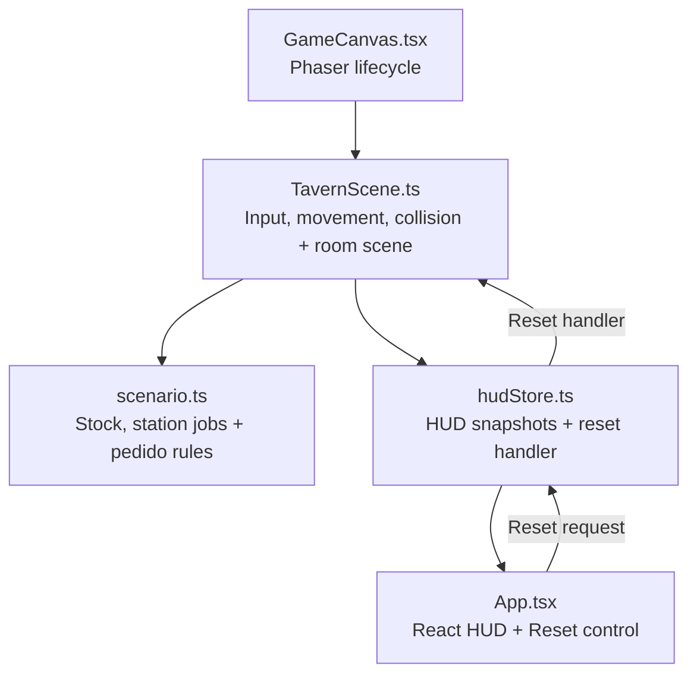

# Tavern Game — Small Scene

A small, resettable room demo for movement, cooking, and serving one customer's pedido. The full design remains in [GDD.md](./GDD.md).

## Run locally

```powershell
npm.cmd install --no-audit --no-fund
npm.cmd run dev
```

Use `npm.cmd run build` for the TypeScript and production bundle checks.
Use `npm.cmd run preview` to serve the built bundle locally.

Click the room, then use WASD/arrows and E. Approach a keg or grill to start or collect its recipe, then approach the seated customer to serve Ale and Meal. Reset room restores the demo.

## Scene ownership



## Scope and verification

This fixed-layout demo has one owner, two table groups, a keg, a grill, finite ingredients, and one customer requesting Ale and Meal. It has no furnishing editor, shop, arrivals, shifts, progression, persistence, audio, or final art; the room and values are demo choices rather than full-game balance.

A successful build checks TypeScript and bundle generation. It does not verify browser movement, collision, interactions, timing, delivery, or reset; runtime verification is pending.
